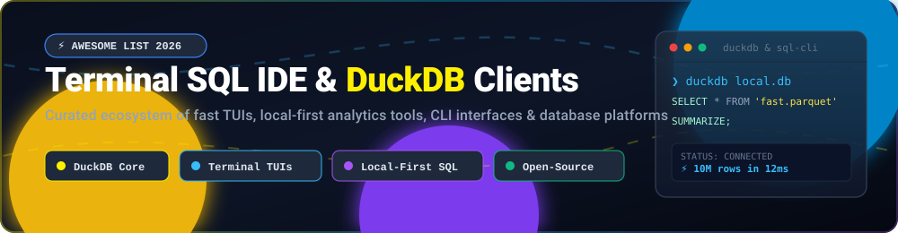
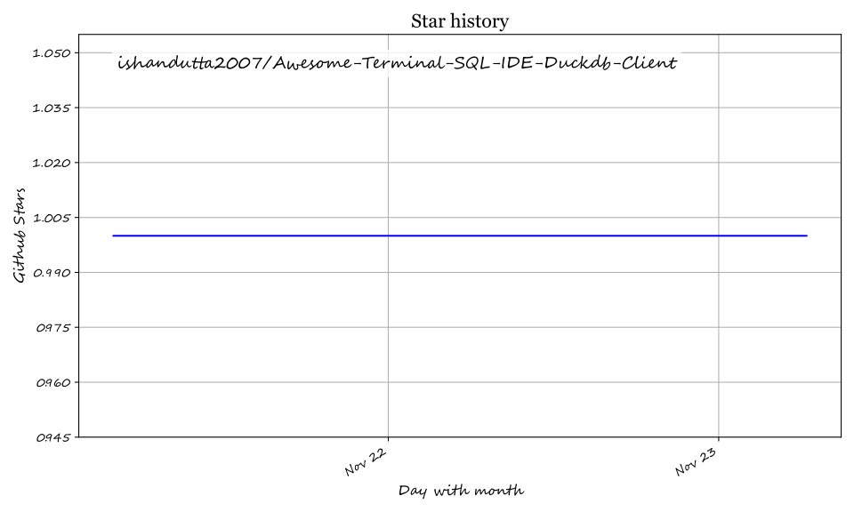

<p align="center">
  
</p>

<p align="center">
  <a href="https://github.com/ishandutta2007/Awesome-Awesome-Awesome"></a><a href="https://discord.gg/jc4xtF58Ve"></a>
  <a href="https://github.com/ishandutta2007/Awesome-Terminal-SQL-IDE-Duckdb-Client/stargazers"></a>
  <a href="https://github.com/ishandutta2007/Awesome-Terminal-SQL-IDE-Duckdb-Client/network/members"></a>
  <a href="https://github.com/ishandutta2007/Awesome-Terminal-SQL-IDE-Duckdb-Client/blob/main/LICENSE"></a>
  <a href="https://duckdb.org/"></a>
  <a href="https://github.com/sindresorhus/awesome"></a>
</p>

# 🚀 Awesome Terminal SQL IDE & DuckDB Client Ecosystem

> **A curated showcase of top-tier Terminal SQL IDEs, DuckDB clients, keyboard-driven TUIs, and local-first analytical data exploration tools.** 🦆⚡💻

[](https://github.com/ishandutta2007/Awesome-Terminal-SQL-IDE-Duckdb-Client/pulls)
[](https://github.com/ishandutta2007/Awesome-Terminal-SQL-IDE-Duckdb-Client)
[](https://awesome.re)

---

## 📖 Overview & SEO Summary

Welcome to the definitive guide and curated collection of **Terminal SQL IDEs**, **Text User Interface (TUI) database clients**, and **DuckDB analytical tools**. Whether you are a **data engineer**, **analytics engineer**, **backend developer**, or **database administrator (DBA)**, this resource catalogs tools that accelerate local-first data workflows, ad-hoc exploratory data analysis (EDA), and database querying without leaving your terminal or firing up heavy desktop suites.

From lightning-fast columnar querying on local Parquet, CSV, and JSON files to multi-database administration (PostgreSQL, MySQL, SQLite, Snowflake, ClickHouse, BigQuery), explore cutting-edge solutions across open-source utilities and production-grade hosted SaaS platforms.

---

## 📑 Table of Contents

- [📊 Sector Overview & Market Dynamics](#-sector-overview--market-dynamics)
- [☁️ SaaS & Hosted Database Platforms](#️-saas--hosted-database-platforms)
- [🛠️ Open-Source GitHub Projects](#️-open-source-github-projects)
  - [⭐ Top-Tier Terminal SQL IDEs & DuckDB Clients](#-top-tier-terminal-sql-ides--duckdb-clients)
  - [🌟 Specialized Engines, Notebooks & Query Frameworks](#-specialized-engines-notebooks--query-frameworks)
- [🤝 How to Contribute](#-how-to-contribute)
- [⚖️ Disclaimer & Best Practices](#️-disclaimer--best-practices)
- [📈 Star History](#-star-history)

---

## 📊 Sector Overview & Market Dynamics

The global database software and database management tools sector represents an estimated **$130B to $160B+ market**, actively pacing toward over **$370B+ by the mid-2030s** at an estimated CAGR of **11–14%**. The market landscape is **moderately fragmented yet characterized by distinct segment concentration**: legacy enterprise database systems (hyperscalers and cloud giants) dominate core infrastructure storage, while developer tooling, analytical query interfaces, and SQL IDEs remain highly competitive and fragmented across modern terminal TUIs, modular local-first engines (e.g., DuckDB), AI-assisted SQL interfaces, and collaborative cloud notebooks.

---

## ☁️ SaaS & Hosted Database Platforms

The following hosted SaaS and commercial SQL IDE platforms are sorted descending by company scale, valuation, or annual revenue:

| 🏢 Platform | 📝 Description | 💰 Pricing (Starting Paid Tier) | 🎁 Free Tier Limit / Free Trial Limit | 📈 Valuation / Revenue (Scale) |
| :--- | :--- | :--- | :--- | :--- |
| **[JetBrains DataGrip](https://jetbrains.com/datagrip/)** | Dedicated cross-platform developer database IDE featuring advanced smart SQL autocompletion, schema inspection, query refactoring, git integration, and comprehensive DuckDB driver connectivity. | **$10.90 / user / month** (billed annually at $109/yr for individual developers; $24.90/mo for organizations) | **30-day full-featured free trial** with unlimited IDE access; 100% free perpetual non-commercial licenses available for verified open-source maintainers, students, and educators. | **~$700M+ ARR** (Bootstrapped & privately held; estimated multi-billion dollar private benchmark valuation with 16M+ users) |
| **[Hex](https://hex.tech)** | Modern collaborative cloud analytics and data workspace merging SQL, Python, DuckDB execution blocks, reactive visualizations, and agentic AI for analytics teams. | **$36 / editor / month** (Professional plan, billed annually) | **Free Community Plan forever**: Up to 3 workspace authors, shared small compute profiles (~4GB RAM, 0.5 CPU), 7-day version history, up to 5 published interactive data apps, and standard AI credits. | **$1.2B Valuation** ($100M Series D round in late 2026; backed by a16z, Sequoia, Peak XV) |
| **[MotherDuck](https://motherduck.com)** | Serverless cloud analytics platform powered by DuckDB, bridging local DuckDB laptop queries with distributed cloud storage, collaborative sharing, and hybrid execution. | **$0.25 / Compute Unit (CU) hour** (Standard pay-as-you-go consumption tier) | **Free Lite Plan forever**: 10 GB free cloud storage/month, 10 free Compute Unit (CU) hours/month for Pulse instances, up to 3 active users, 2 service accounts, and community support. | **$400M Valuation** ($52.5M Series B led by Felicis and a16z; $100M total funding) |
| **[Deepnote](https://deepnote.com)** | Real-time collaborative cloud data notebook built for data teams with native DuckDB integrations, point-and-click SQL cells, and interactive dashboard publishing. | **$59 / editor / month** (Team plan, billed annually) | **Free Starter Plan forever**: Up to 3 editors with unlimited viewers, 5 active projects, unlimited basic machines (2 vCPU, 5 GB RAM), 10 AI completions/month, and 7-day version history. | **~$80M Valuation** ($20M Series A led by Index Ventures & Accel; ~$3.9M estimated ARR) |
| **[Observable](https://observablehq.com)** | Collaborative web workspace and notebook platform for reactive SQL/JavaScript dashboards and exploratory analysis powered by DuckDB-Wasm. | **$20 / editor / month** (Pro plan, billed annually) | **Free Community Plan forever**: Solo developer workspace, 1 GB file attachments/month, 50 minutes cloud compute/month, basic AI token quota, watermarked embeddable charts, and community support. | **~$46M+ Total Funding** (Series B led by Menlo Ventures, Sequoia Capital, and Acrew Capital) |
| **[DBeaver Cloud](https://dbeaver.com)** | Enterprise collaborative web-and-desktop database workspace with team connection pooling, shared SQL scripts, and centralized credential governance. | **$1,630 / team / year** (DBeaver Team Edition starting baseline for 1 Admin + 2 Developers) | **14-day free trial** of DBeaver PRO & Team Edition (full feature set with multi-user team evaluation); CloudBeaver AWS Marketplace offers **30-day free trial** for EC2 instances. | **~$10M–$25M Estimated ARR** ($6M Seed round raised from Headline and Prospective Technologies) |
| **[TablePlus](https://tableplus.com)** | Blazing-fast, native, lightweight commercial GUI client for relational, analytical, and embedded databases including DuckDB, PostgreSQL, SQLite, and ClickHouse. | **$89 / perpetual license** (Standard 1-seat license with 1 year of continuous updates) | **Free Tier forever**: Native application usable indefinitely with a strict cap of **2 active query tabs**, **2 open workspace windows**, and 2 advanced filters at a time. | **Profitable Bootstrapped** (Privately held, highly profitable commercial software vendor; zero external institutional VC raised) |

---

## 🛠️ Open-Source GitHub Projects

The open-source ecosystem provides powerful, keyboard-centric, and privacy-preserving tools for managing and querying DuckDB and SQL databases. Entries are sorted strictly in descending order by **GitHub Stargazers Count**.

### ⭐ Top-Tier Terminal SQL IDEs & DuckDB Clients

| 📦 Repository & Project | 🌟 Stargazers Badge | 💻 Tech Stack | 🎯 Description & Primary Use Case |
| :--- | :--- | :--- | :--- |
| **[Supabase Studio (supabase/supabase)](https://github.com/supabase/supabase)** | [](https://github.com/supabase/supabase/stargazers) | TypeScript, Next.js, Go | Comprehensive open-source Firebase alternative featuring an embedded SQL editor, table view, schema visualizer, and local Docker self-hosting. |
| **[Apache Superset (apache/superset)](https://github.com/apache/superset)** | [](https://github.com/apache/superset/stargazers) | Python, TypeScript, React | Powerful enterprise-grade data exploration, visualization, and SQL Lab IDE with native DuckDB SQLAlchemy support for querying local datasets. |
| **[DBeaver Community (dbeaver/dbeaver)](https://github.com/dbeaver/dbeaver)** | [](https://github.com/dbeaver/dbeaver/stargazers) | Java | Universal open-source desktop database tool supporting DuckDB via JDBC alongside PostgreSQL, MySQL, SQLite, Oracle, Snowflake, and 100+ database engines. |
| **[Metabase (metabase/metabase)](https://github.com/metabase/metabase)** | [](https://github.com/metabase/metabase/stargazers) | Clojure, TypeScript | User-friendly self-hosted business intelligence and SQL exploration platform with community DuckDB drivers for building dashboards over local files. |
| **[DuckDB Core CLI (duckdb/duckdb)](https://github.com/duckdb/duckdb)** | [](https://github.com/duckdb/duckdb/stargazers) | C++, C | Official ultra-fast analytical in-process SQL database engine with an interactive terminal shell that reads and queries Parquet, CSV, JSON, and S3 natively. |
| **[Beekeeper Studio (beekeeper-studio/beekeeper-studio)](https://github.com/beekeeper-studio/beekeeper-studio)** | [](https://github.com/beekeeper-studio/beekeeper-studio/stargazers) | Vue, TypeScript, Electron | Modern, clean, and intuitive open-source SQL editor and database manager with dedicated DuckDB, PostgreSQL, MySQL, and SQLite connectivity. |
| **[Vanna AI (vanna-ai/vanna)](https://github.com/vanna-ai/vanna)** | [](https://github.com/vanna-ai/vanna/stargazers) | Python | Open-source Python RAG framework for Natural Language to SQL generation that connects directly with DuckDB, SQLite, PostgreSQL, and local LLMs. |
| **[pgcli (dbcli/pgcli)](https://github.com/dbcli/pgcli)** | [](https://github.com/dbcli/pgcli/stargazers) | Python | Terminal client for PostgreSQL with intelligent auto-completion, multi-line editing, and syntax highlighting powered by prompt_toolkit. |
| **[mycli (dbcli/mycli)](https://github.com/dbcli/mycli)** | [](https://github.com/dbcli/mycli/stargazers) | Python | Terminal client for MySQL, MariaDB, and Percona with auto-completion and syntax highlighting. |
| **[PRQL (PRQL/prql)](https://github.com/PRQL/prql)** | [](https://github.com/PRQL/prql/stargazers) | Rust | Pipelined Relational Query Language that compiles to SQL; integrates seamlessly with DuckDB for cleaner, error-resistant analytical queries. |
| **[usql (xo/usql)](https://github.com/xo/usql)** | [](https://github.com/xo/usql/stargazers) | Go | Universal command-line interface for SQL databases with syntax highlighting and auto-completion, natively supporting DuckDB, Postgres, and SQLite. |
| **[SQLFluff (sqlfluff/sqlfluff)](https://github.com/sqlfluff/sqlfluff)** | [](https://github.com/sqlfluff/sqlfluff/stargazers) | Python | Dialect-flexible SQL linter and auto-formatter designed specifically for modern ELT pipelines with native DuckDB SQL dialect support. |
| **[VisiData (saulpw/visidata)](https://github.com/saulpw/visidata)** | [](https://github.com/saulpw/visidata/stargazers) | Python | Terminal multitool for exploring, filtering, and summarizing large tabular data files, supporting direct DuckDB, SQLite, Parquet, and CSV ingestion. |
| **[Evidence (evidence-dev/evidence)](https://github.com/evidence-dev/evidence)** | [](https://github.com/evidence-dev/evidence/stargazers) | JavaScript, Svelte | Code-first open-source business intelligence framework generating fast web reports from Markdown and SQL powered by an embedded DuckDB engine. |
| **[Harlequin (tconbeer/harlequin)](https://github.com/tconbeer/harlequin)** | [](https://github.com/tconbeer/harlequin/stargazers) | Python, Textual | The premier Terminal SQL IDE built specifically for DuckDB and tabular formats, featuring a catalog explorer, multi-tab query editor, and data pager. |
| **[SQLChat (sqlchat/sqlchat)](https://github.com/sqlchat/sqlchat)** | [](https://github.com/sqlchat/sqlchat/stargazers) | TypeScript, Next.js | Chat-based SQL client powered by conversational AI to generate, execute, and analyze SQL queries against local and cloud databases. |
| **[Rainfrog (achristmascarl/rainfrog)](https://github.com/achristmascarl/rainfrog)** | [](https://github.com/achristmascarl/rainfrog/stargazers) | Rust, Ratatui | Lightning-fast Vim-inspired terminal database management TUI with multi-tier database drivers, including PostgreSQL, SQLite, and DuckDB. |
| **[lazysql (jorgerojas26/lazysql)](https://github.com/jorgerojas26/lazysql)** | [](https://github.com/jorgerojas26/lazysql/stargazers) | Go | Fast keyboard-driven terminal database client built in Go with Vim-like shortcuts, table inspection, and interactive record navigation. |
| **[Dataherald (Dataherald/dataherald)](https://github.com/Dataherald/dataherald)** | [](https://github.com/Dataherald/dataherald/stargazers) | Python | Enterprise-grade Natural Language to SQL engine designed to answer complex ad-hoc analytics questions over relational schemas and DuckDB. |
| **[Roapi (roapi/roapi)](https://github.com/roapi/roapi)** | [](https://github.com/roapi/roapi/stargazers) | Rust, Apache Arrow | Automatically spins up read-only SQL, REST, and GraphQL endpoints directly on top of DuckDB, Parquet, CSV, and SQLite datasets. |
| **[Gobang (TaKO8Ki/gobang)](https://github.com/TaKO8Ki/gobang)** | [](https://github.com/TaKO8Ki/gobang/stargazers) | Rust, Ratatui | Cross-platform TUI database management tool written in Rust for keyboard-centric querying and table inspection across MySQL, PostgreSQL, and SQLite. |
| **[litecli (dbcli/litecli)](https://github.com/dbcli/litecli)** | [](https://github.com/dbcli/litecli/stargazers) | Python | CLI for SQLite databases with intelligent auto-completion, multi-line editing, and syntactic highlighting for local embedded database workflows. |
| **[dblab (danvergara/dblab)](https://github.com/danvergara/dblab)** | [](https://github.com/danvergara/dblab/stargazers) | Go | Interactive terminal UI client for PostgreSQL, MySQL, and SQLite that enables interactive filtering and quick query execution. |
| **[SQLPage (sqlpage/SQLPage)](https://github.com/sqlpage/SQLPage)** | [](https://github.com/sqlpage/SQLPage/stargazers) | Rust | Turn SQL queries into interactive web applications and internal admin dashboards with zero frontend code, fully compatible with DuckDB and SQLite. |
| **[sq (neilotoole/sq)](https://github.com/neilotoole/sq)** | [](https://github.com/neilotoole/sq/stargazers) | Go | Swiss-army knife CLI utility to inspect, query, join, diff, and convert flat data files (CSV, JSON, Excel, Parquet) and relational SQL databases. |
| **[JupySQL (ploomber/jupysql)](https://github.com/ploomber/jupysql)** | [](https://github.com/ploomber/jupysql/stargazers) | Python | Run DuckDB, PostgreSQL, and Snowflake queries directly inside JupyterLab or terminal IPython with minimal memory footprint and native plotting. |

---

### 🌟 Specialized Engines, Notebooks & Query Frameworks

Beyond dedicated terminal clients, several open-source libraries provide direct integrations for terminal-centric and local-first SQL execution:

* 🦆 **[DuckDB Local Web UI](https://duckdb.org/docs/guides/network/web_ui)** — Official built-in interactive browser UI launched directly from the DuckDB terminal CLI via `duckdb -ui` for visual query inspection and notebook cells.
* 📦 **[Cube.js](https://github.com/cube-js/cube)** [](https://github.com/cube-js/cube/stargazers) — Universal semantic layer and caching middleware providing SQL API endpoints on top of DuckDB and analytical data stores.
* 🧩 **[Malloy](https://github.com/malloydata/malloy)** [](https://github.com/malloydata/malloy/stargazers) — Experimental data modeling and query language developed to replace SQL, running natively against DuckDB, BigQuery, and Postgres.

---

## 💡 Recommended Terminal Workflow

For the ultimate keyboard-first local data engineering environment:

```bash
# 1. Inspect Parquet and tabular files directly in the terminal
harlequin "my_analytics.db"

# 2. Slice and summarize gigabytes of raw data in milliseconds with DuckDB
duckdb -c "SELECT department, count(*), avg(salary) FROM 'employees.parquet' GROUP BY ALL;"

# 3. Explore complex schema tables with VisiData
vd "large_transactions.parquet"
```

---

## 🤝 How to Contribute

Contributions, bug reports, and project submissions are very welcome!

1. 🍴 Fork the repository.
2. 📝 Add or update entries in `README.md` following the table formatting and criteria.
3. 🔗 Verify that all links are active and descriptions remain factual and concise.
4. 🚀 Submit a pull request with a brief explanation of the tool and why it benefits the ecosystem.

---

## ⚖️ Disclaimer & Best Practices

- This is a community-maintained curated list for educational and discovery purposes; inclusion does not imply an official endorsement.
- Terminal SQL clients, local database binaries, and DuckDB extensions execute arbitrary code and file system reads; always verify queries and database credentials in shared or multi-tenant production environments.

---

<p align="center">
  <b>⭐ Star this repository if you find it helpful for your terminal and DuckDB workflows! ⭐</b>
</p>

## 📈 Star History

<a href="https://star-history.com/#ishandutta2007/Awesome-Terminal-SQL-IDE-Duckdb-Client&Timeline" align="center">
  <picture>
    <source media="(prefers-color-scheme: dark)" srcset="assets/ishandutta2007_Awesome-Terminal-SQL-IDE-Duckdb-Client_growth.svg">
    
  </picture>
</a>
